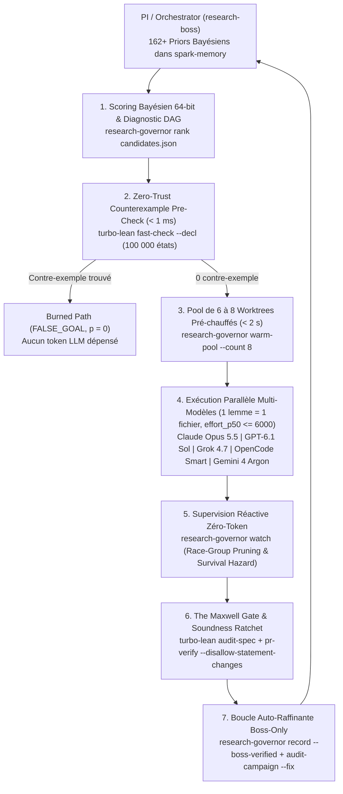

# Plan d'Exécution Long Terme : Refondation `EVMYulLean 2.0`, Branchement `Verity 2.0` & Campagne Autonome de Conformité Ethereum (`fractal-autoresearch`)

## 1. Pourquoi prioriser `EVMYulLean 2.0` avant toute expansion

[`lfglabs-dev/EVMYulLean`](../.lake/packages/evmyul) (`11 363` lignes réparties sur `34` fichiers `.lean`) constitue la **racine de confiance sémantique** de Verity pour les couches Layer 2 (`IR → Yul`) et Layer 3 (`Yul → EVM`).
Or, l'audit direct du dépôt révèle aujourd'hui **sept dettes structurelles** dans `EVMYulLean` qu'il est indispensable de résorber *avant* de brancher les passes d'optimisation de bout en bout ou de lancer une campagne de conformité multi-mois :

| Axe | État actuel dans `EVMYulLean` | Cible `EVMYulLean 2.0` (Priorité P0) |
| :--- | :--- | :--- |
| **1. Specs Ethereum & Forks** | • Fork unique quasi-Cancun codé en dur. • Absence de Prague/Pectra (EIP-7702, EIP-2537 BLS12-381, EIP-2935, EIP-7623) et Osaka (EIP-7951). • `TODO: Yul halting for SELFDESTRUCT` (EIP-6780 incomplet côté Yul). | • Paramétrage explicite par `Fork` (`Shanghai`, `Cancun`, `Prague`, `Osaka`). • Support complet EIP-6780, EIP-4844/7516, EIP-7702, EIP-2537, EIP-2935, EIP-7623, EIP-7951. |
| **2. Support du Gas (EVM + Yul)** | • `Yul/Interpreter.lean` ignore l'argument gas (`_`) dans `CALL`/`STATICCALL`/`DELEGATECALL`/`CALLCODE` et ne déduit aucun coût de gas. • `EVM/Gas.lean` indexe directement `s.stack[0]!`, `s.stack[1]!` avec des accès partiels `!`. | • Modèle de gas **pur, total et sans accès partiels `!`** partagé entre `.EVM` et `.Yul`. • Comptabilité exacte par `Fork` (EIP-2929 warm/cold, EIP-2200/3529 `SSTORE` + refunds $A_r$, expansion mémoire $C_m$, règle $63/64$ `L(n)`). • Unification directe avec `Verity.GasCostModel`. |
| **3. Style, Abstractions & Simplification** | • `UInt256` défini ad hoc sur `Fin 11579208...` au lieu de `BitVec 256`. • 8 blocs de 50 lignes copiés-collés dans `Yul/Interpreter.lean` (`primCall`). • `dbg_trace` dans `Semantics.lean:222`, `partial def D_J_aux`, imports dupliqués, typo `.OutOfGass`. | • `UInt256` unifié sur `BitVec 256` (`bv_decide`, `omega`) et `Verity.Core.Uint256`. • Combinateur unique `execMessageCall (mode : CallMode)` factorisant `CALL`/`STATICCALL`/`DELEGATECALL`/`CALLCODE`. • `0 partial def`, `0 dbg_trace`, hygiène `check_lean_hygiene.py` stricte. |
| **4. Performance (Build & Exécution)** | • `set_option maxHeartbeats 400000` dans `Yul/Interpreter.lean`. • `Finmap` et listes d'association lentes. • Précompilés/Keccak bloqués par FFI C opaque pour la réduction noyau (`decide`). | • Découpage modulaire (`maxHeartbeats ≤ 200000`), lemmes `@[simp]` d'étape. • Dual-backend : FFI C/native (`lean-native --c-abi` + `evmyul-t8n`) pour l'exécution rapide et implémentation Lean pure prouvée équivalente pour `decide`. |
| **5. Intégration `turbo-lean`** | • Non configuré sur `EVMYulLean` (builds `lake` froids, aucun audit de vacuité). | • Daemon `turbo-lean` (`agent-step` `< 2 ms`), `fast-check` (`lean-native-core` `100 000` états en `< 1 ms`), `audit-spec` et `pr-verify --mode trusted`. |
| **6. Specs & Métaspecs** | • Seulement 39 petits lemmes utilitaires (`sizeOf`, `Stack.size`) et **0 théorème sémantique** sur `EVM.step` ou `Yul.step`. | • Bibliothèque `EvmYul/Specs/` & `EvmYul/MetaSpecs/` : 5 Métaspecs fondamentales (Commutation `Yul ≃ EVM`, Algèbre de Frame/Lenses, Monotonie du Gas & Terminaison sans fuel, Invariant `STATICCALL`, Rollback atomique sur `REVERT`/Exception). |
| **7. Revue inter-formalisations** | • Références partielles aux numéros d'équations du Yellow Paper (souvent marquées `TODO(check)`). | • Matrice d'alignement formel et tests croisés contre **Yellow Paper**, **EELS (`execution-specs`)**, **KEVM (`evm-semantics`)**, **`Consensys/evm-dafny`**, et **Hol4/Isabelle-EVM**. |

---

## 2. Les 5 Métaspecs de `EVMYulLean 2.0` (`EvmYul/MetaSpecs/`)

Au lieu d'écrire des centaines de lemmes ad hoc par opcode, `EVMYulLean 2.0` structure ses preuves autour de **5 Métaspecs génériques** auditées par `turbo-lean --json audit-spec` (`0 vacuous`, `0 trivial`, `0 shadowed`) et testées par mutation (`#rsgb_kill`) :

1. **`MetaSpec.DialectCommutation` (`Yul ≃ EVM` Step Simulation)** :
   - Exploite la factorisation existante `Semantics.step {τ : OperationType}` pour prouver une fois pour toutes que, pour toute opération partagée `op : Operation`, l'évaluation Yul sur arguments `(s_yul, args)` projette exactement sur le même `SharedState` et la même consommation de gas $\Delta g$ que l'évaluation EVM sur une pile préfixée par `args`.
2. **`MetaSpec.StateLensAlgebra` (Unified World-State, Storage & Memory Frame Algebra)** :
   - Loi algébrique générique `read_write_same` / `read_write_ne` / `unchangedExcept` sur les 6 sous-espaces d'état (`AccountMap`, `StorageMap`, `TransientStorageMap`, `ByteArray` Memory, `Substate.accessedStorageKeys`/`accessedAccounts`, `Substate.logs`), alignée 1:1 avec `Verity.Specs.StorageLoc` et `Verity.Specs.unchangedExcept`.
3. **`MetaSpec.GasMonotonicityAndTermination` (Well-Founded Gas Measure)** :
   - Prouve que toute transition élémentaire consomme un gas $\Delta g \ge 0$ (et $\Delta g \ge 1$ hors `STOP`/`RETURN`/`REVERT`/`JUMPDEST`) et que les appels imbriqués respectent la borne stricte $L(g) = g - \lfloor g/64 \rfloor < g$ (ou $I_e < 1024$). Permet de remplacer le paramètre artificiel `fuel : ℕ` par une récursion bien fondée sur le couple lexicographique `(1024 - depth, gasAvailable, pc_run)`.
4. **`MetaSpec.StaticCallImmutability` (`STATICCALL` / `perm = false` Soundness)** :
   - Prouve par induction sur l'arbre d'appels mutuel (`call` / `Θ` / `step`) que lorsque `executionEnv.perm = false`, toute exécution qui termine avec succès préserve à l'identique `accountMap` (balances, nonces, codes, storages persistants), `transientStorage`, `createdAccounts` et `substate.logs`. Corrige également l'abstraction `hopCallView` côté Verity pour l'aligner sur `STATICCALL`.
5. **`MetaSpec.TransactionalRollback` (Revert & Exceptional Halt Atomicity)** :
   - Prouve que sur `REVERT` ou exception (`OutOfGas`, `StackUnderflow`, `BadJumpDestination`, `StaticModeViolation`), l'état monde `(σ, transientStorage, logs)` est intégralement restauré à l'état d'entrée de la frame d'appel, que `returnData` est vide sur exception et égal au slice mémoire sur `REVERT`, et que le gas restant est `0` sur exception contre `g_avail - C_mem` sur `REVERT`.

---

## 3. Matrice de Revue Croisée contre les Formalisations de l'EVM & le Yellow Paper

Chaque module de `EVMYulLean 2.0` est vérifié par rapport à 5 sources formelles et normatives de référence :

| Source de référence | Ce que nous en extrayons dans `EVMYulLean 2.0` | Mécanisme de vérification (`Zero-Trust Oracle`) |
| :--- | :--- | :--- |
| **1. Ethereum Yellow Paper** (Équations $\Upsilon, \Theta, \Lambda, \Xi, \Omega$, Appendices G, H, K) | Table exacte des groupes de coût (`Wzero..Wextaccount`), formules $C_{\text{SSTORE}}$, $C_{\text{MEM}}$, $C_{\text{CALL}}$, $L(n)$, $D_J(c)$, règles de création $\Lambda$ et d'auto-destruction. | Traçabilité 1:1 `@[yellow_paper_eq n]` dans les docstrings Lean + élimination de tous les `TODO(check)` de `EVM/Gas.lean` et `EVM/Semantics.lean`. |
| **2. EELS (`ethereum/execution-specs`)** | Spécification Python exécutable officielle par fork (`shanghai`, `cancun`, `prague`, `osaka`), incluant EIP-7702, EIP-2537, EIP-2935, EIP-7623. | Exécution différentielle via l'adaptateur `evmyul-t8n` contre `ethereum/execution-spec-tests` (EEST). |
| **3. `Consensys/evm-dafny`** | Préconditions totales de profondeur de pile ($\delta, \alpha$), séparation pure entre calcul de gas et transition d'état, invariants de frame mémoire/stockage sans accès `!` partiels. | Traduction des signatures totales de `evm-dafny` vers `EvmYul/EVM/Gas.lean` et `EvmYul/Specs/StackSafety.lean` (zéro `.get!` non gardé). |
| **4. KEVM (`runtimeverification/evm-semantics`)** | Lemmes symboliques de simplification bit-vectorielle (`chop`, `bool2Word`, masques 160/256 bits, arithmétique signée `sdiv`/`smod`/`sar`/`signextend`, règles `SSTORE` dirty/clean). | Import dans `EvmYul/Specs/UInt256Lemmas.lean` et `EvmYul/Specs/GasLemmas.lean`, prouvés par `bv_decide` / `omega` et pré-vérifiés par `turbo-lean fast-check`. |
| **5. Isabelle-EVM / HOL4-EVM** | Modélisation Inductive de `D_J` (validation `JUMPDEST` totale sans `partial def`) et lemmes d'encodage big-endian `ByteArray ↔ UInt256`. | Remplacement de `partial def D_J_aux` par une définition récursive structurelle avec preuve de terminaison et de correction `mem_D_J_iff`. |

---

## 4. Architecture d'Orchestration `fractal-autoresearch` (The Maxwell Gate)

L'exécution du plan à long terme est pilotée par **`fractal-autoresearch` (`research-governor` / The Maxwell Gate)** selon le cycle certifié **`[Conjecture -> Specification -> Certification]`** :

### Règles Invariantes du Gouverneur (`ResearchGovernor/Spec.lean`, 17 théorèmes, `0 sorryAx`)
1. **Décomposition Récursive Stricte (`effort_p50 <= 6000` tokens, `effort_p90 / effort_p50 <= 3.5`)** :
   - Chaque tâche de certification (`GRIND`/`PROVE`) cible **1 lemme clé = 1 fichier `.lean` = 1 worker** dans un worktree isolé pré-chauffé via `research-governor warm-pool`.
   - Toute branche avec `effort_p50 > 6000` ou `effort_uncertainty_ratio > 3.5` est automatiquement marquée `"split_recommended": true` par `research-governor rank` et décomposée via une sonde `Conjecture` (`PROBE`).
2. **Isolation des Réductions Lourdes (`rfl` / `decide +kernel`)** :
   - Les témoins exécutables de conformité ou tables de vecteurs sont isolés dans des feuilles `.lean` dédiées compilées une seule fois en `.olean`, afin que chaque pas tactique `turbo-lean agent-step` reste `< 2 s`.
3. **Juge Mécanique Exclusif (`governor_accept_gate_sound`)** :
   - Aucun worker ne peut modifier l'énoncé d'une spécification (`spec_hash_before == spec_hash_after`), introduire un axiome (`forbidden_axioms == 0`) ou valider une spec vacante (`vacuous_specs == 0`).
   - Seul le Boss enregistre la télémétrie via `research-governor record --boss-verified` et exécute `research-governor audit-campaign --fix` à la fin de chaque vague.

---

## 5. Plan d'Exécution Phasé (Horizon 6 Vagues Majeures → Boucle Multi-Mois)

### Phase I — Fondation `EVMYulLean 2.0` : Refactor, `BitVec 256`, Gas Total, Specs & `turbo-lean` (Vagues E1 à E3)

#### Vague E1 — Hygiène, `BitVec 256`, Déduplication & Passage sur `turbo-lean` (Semaines 1–2)
- **`E1-probe-architecture`** (`PROBE`, `Claude Opus 5.5`) : Cartographie complète des dépendances entre `EvmYul/UInt256.lean`, `BitVec 256`, `Verity.Core.Uint256` et les 34 fichiers d'`EVMYulLean`.
- **`E1-uint256-bitvec-bridge`** (`PROVE`, `Grok 4.7`) : Pont d'isomorphisme `EvmYul.UInt256 ≃ BitVec 256 ≃ Verity.Core.Uint256` avec tactiques `bv_decide` et simplification automatique des 25 opérations purement arithmétiques/bit-à-bit.
- **`E1-eliminate-partials-and-hygiene`** (`PROVE`, `OpenCode Smart`) : Remplacement de `partial def D_J_aux` par une fonction totale bornée avec preuve `mem_D_J_iff`, suppression des `dbg_trace` et imports dupliqués, correction de `.OutOfGass`, et activation de `check_lean_hygiene.py` + `turbo-lean` sur `EVMYulLean`.
- **`E1-dedup-yul-message-calls`** (`PROVE`, `GPT-6.1 Sol`) : Factorisation des 8 branches d'appels de `EvmYul/Yul/Interpreter.lean` (`primCall` pour `CALL`, `STATICCALL`, `CALLCODE`, `DELEGATECALL`) en un unique combinateur paramétré `execYulMessageCall` avec `maxHeartbeats ≤ 200000`.
- **`E1-pure-keccak-ffi-equivalence`** (`PROVE`, `Gemini 4 Argon`) : Unification de `EvmYul/SpongeHash/Keccak256.lean` et `Compiler/Keccak/Sponge.lean` pour permettre l'évaluation noyau `by decide` sans blocage FFI C tout en conservant l'accélération native au runtime.
- **`E1-step-projection-simps`** (`PROVE`, `Grok 4.7`) : Génération des lemmes `@[simp]` d'étape par opcode (`EVM.step_add`, `EVM.step_sload`, `Yul.primCall_sstore`, etc.) pour ramener chaque `turbo-lean agent-step` sous `5 ms`.

#### Vague E2 — Support Complet du Gas (EVM + Yul), Sans Accès Partiels `!` & Multi-Fork Cancun/Prague/Osaka (Semaines 3–4)
- **`E2-probe-fork-and-gas-matrix`** (`PROBE`, `Claude Opus 5.5`) : Audit croisé des formules de gas et d'opcodes entre `EVM/Gas.lean`, le Yellow Paper, EELS (`cancun`/`prague`/`osaka`) et `Consensys/evm-dafny`.
- **`E2-total-stack-safe-gas`** (`PROVE`, `GPT-6.1 Sol`) : Refactoring de `EvmYul/EVM/Gas.lean` en fonctions pures totales paramétrées par `Fork` et opérandes typés (zéro `s.stack[i]!`), avec preuve de raffinement vers `Verity.GasCostModel`.
- **`E2-yul-gas-accounting`** (`PROVE`, `Gemini 4 Argon`) : Intégration de la comptabilité de gas complète dans `EvmYul/Yul/Interpreter.lean` (coût des primops, expansion mémoire $C_m$, `Csstore`/`Csload` EIP-2929, règle $63/64$ `Ccallgas` dans `CALL`/`STATICCALL`/`DELEGATECALL`, et propagation de `.OutOfGas`).
- **`E2-prague-eip7702-eip2935-eip7623`** (`PROVE`, `OpenCode Smart`) : Implémentation formelle dans `EVMYulLean` des règles Prague/Pectra : indicateur de délégation EIP-7702 (`0xef0100 || addr`), coûts plancher calldata EIP-7623 dans `intrinsicGas`, et `BLOCKHASH` EIP-2935.
- **`E2-prague-eip2537-eip7951-precompiles`** (`PROVE`, `Grok 4.7`) : Ajout des précompilés BLS12-381 (`0x0b..0x11`, EIP-2537) et `P256VERIFY` (`0x100`, EIP-7951) avec barèmes de gas exacts.
- **`E2-eip6780-selfdestruct-and-refunds`** (`PROVE`, `GPT-6.1 Sol`) : Finalisation d'EIP-6780 (`SELFDESTRUCT` en même transaction dans `.EVM` et `.Yul`) et du compteur de remboursement $A_r$ borné par $\lfloor \text{gasUsed} / 5 \rfloor$ (EIP-3529).

#### Vague E3 — Les 5 Métaspecs d'`EVMYulLean 2.0` & Alignement KEVM / `evm-dafny` (Semaines 5–6)
- **`E3-probe-kevm-dafny-lemmas`** (`PROBE`, `Claude Opus 5.5`) : Extraction des invariants clés de `Consensys/evm-dafny` et `runtimeverification/evm-semantics` (KEVM) et vérification précoce par `turbo-lean fast-check`.
- **`E3-metaspec-dialect-commutation`** (`PROVE`, `GPT-6.1 Sol`) : Preuve de `MetaSpec.DialectCommutation` (`step (τ := .Yul)` commute avec `step (τ := .EVM)` sur tous les `Operation` partagés, état et gas inclus).
- **`E3-metaspec-state-lens-algebra`** (`PROVE`, `Grok 4.7`) : Preuve de `MetaSpec.StateLensAlgebra` (`read_write_same`, `read_write_ne`, `unchangedExcept` sur `AccountMap`, `StorageMap`, `TransientStorage`, `Memory`, `Substate`).
- **`E3-metaspec-gas-termination`** (`PROVE`, `Claude Opus 5.5`) : Preuve de `MetaSpec.GasMonotonicityAndTermination` (décroissance stricte de la mesure lexicographique `(1024 - depth, gasAvailable)` et élimination de `OutOfFuel` sous budget de gas borné).
- **`E3-metaspec-staticcall-immutability`** (`PROVE`, `OpenCode Smart`) : Preuve de `MetaSpec.StaticCallImmutability` (invariance totale du world-state et des logs sous `perm = false`) et alignement de `hopCallView`.
- **`E3-metaspec-transactional-rollback`** (`PROVE`, `Gemini 4 Argon`) : Preuve de `MetaSpec.TransactionalRollback` (restauration exacte de l'état monde sur `REVERT` et exception, avec comptabilité exacte du gas brûlé vs restitué).

---

### Phase II — Branchement End-to-End de `Verity 2.0` sur `EVMYulLean 2.0` (Vague V5, Semaines 7–8)

Une fois `EVMYulLean 2.0` stabilisé et certifié par `turbo-lean`, toutes les briques construites lors des Vagues 1 à 4 de Verity 2.0 se branchent directement sans dette de réécriture :
1. **Branchement de `CertifiedPatchPack` & `SelectorDispatchTree`** dans le pipeline actif (`Compiler/Codegen.lean`, `Compiler/Pipeline.lean`, `Compiler/Proofs/EndToEnd`).
2. **Migration complète de `Contracts/ERC20`, `Ledger` et `Vault`** vers `FnSpec.Satisfies`, `unchangedExcept`, `sumBalancesNat` et la tactique `verity_prove_spec`.
3. **Élimination des axiomes mémoires/Keccak superflus** (`keccak256_memory_slice_matches_evm`, `evm_scratch_space_single_word`) par preuve directe sur `MetaSpec.StateLensAlgebra` et le sponge Keccak unifié.
4. **Certificat de Compilation par Artefact (`CertificateBundle`)** : Génération automatique d'un reçu JSON/Lean liant le hash du contrat source, le théorème `FnSpec.Satisfies`, le `CertifiedPatchPack` exécuté, la borne de gas prouvée sur `EVMYulLean 2.0` (`Fork.Prague`), et la liste exacte des préimages Keccak (`CollisionFreeOn (preimages m)`).

---

### Phase III — Campagne Autonome Multi-Mois de Conformité Ethereum Globale (Mois 3 à 12+)

Pilotée en continu par `fractal-autoresearch` (`schedule_wakeup` quotidien + workers isolés gouvernés par The Maxwell Gate) :

1. **Adaptateur Natif `evmyul-t8n` & Boucle Multi-Clients (`ethereum/tests` + EEST + EELS)** :
   - Compilation native de `EVMYulLean 2.0` (via `lean-native` / Lake executable) exposant l'interface standard `t8n` (`state_test` / `blockchain_test`).
   - Exécution différentielle quotidienne de chaque shard EEST (`Cancun`, `Prague`, `Osaka`) sur `evmyul-t8n`, `revm`, `geth`, `reth`, `evmone` et EELS Python.
   - Toute divergence ouvre automatiquement une branche DAG dans `fractal-autoresearch` avec un test minimal reproductible en `< 10 ms`.
2. **Validation de Traduction Certifiée `Yul ↔ EVM Bytecode` (Sortie de `solc` de la TCB)** :
   - Grâce à `MetaSpec.DialectCommutation` dans `EVMYulLean 2.0`, vérification automatique par fonction que le bytecode EVM émis par `solc` simule exactement le code Yul émis par Verity (avec rejet fail-closed si `solc` introduit une divergence).
3. **Superoptimisation EVM Certifiée guidée par le Gas Réel d'`EVMYulLean 2.0`** :
   - Boucle `ShimArena` + `fractal-autoresearch` proposant des règles `CertifiedRuleOn denote` dont à la fois l'équivalence sémantique (`preserves_eval`) et le gain de gas (`improves_cost` sur `EvmYul.EVM.Gas` au fork cible) sont prouvés dans le noyau Lean.
4. **Ingestion Continue du Corpus Réel (Sourcify / Etherscan)** :
   - Transpilation quotidienne d'échantillons de contrats vérifiés via `SolidityImport → EmitVerity → compile`, mesure du taux de couverture et fuzzing différentiel du bytecode sur `evmyul-t8n` et `revm`.

---

## 6. État d'Exécution `EVMYulLean 2.0` & Feuille de Route Unifiée Issue de la Revue Multi-Modèles (Claude Fable 5.1, GPT-6 Astra, OpenCode `builtin/smart`)

### 6.1 Bilan `EVMYulLean 2.0` (Vagues E1 → E4 Terminées et Certifiées)
- **Branche `evmyullean-2.0` (`ed91989`)** épinglée dans Verity :
  - **255 théorèmes prouvés**, **`0 sorryAx`**, **`0 native_decide`**, **`0 partial def`** sur le chemin de preuve.
  - **Unification `UInt256 := BitVec 256`** et **Modèle de Gas pur et total** (`EvmYul/EVM/Gas.lean` + `EvmYul/Yul/GasInterpreter.lean`) paramétré par `Fork` (`Shanghai`, `Cancun`, `Prague`, `Osaka`), couvrant EIP-2929, EIP-2200/3529, EIP-1153, EIP-4844/7516, EIP-6780, EIP-7702, EIP-2537, EIP-2935, EIP-7623 et EIP-7951.
  - **5 Métaspecs prouvées** (`DialectCommutation`, `StateLensAlgebra`, `GasTermination`, `StaticCallAndRollback`, `YulEvmGasEquivalence`) + théorèmes de simulation d'appels `MessageCallSimulation.lean`.

### 6.2 Ordre de Dépendance Strict pour Clore les Phases Restantes de Verity (Part 1 des Revues Architecturales)
Les rapports complets sont archivés dans `artifacts/architecture_reviews/` (`review_fable_5_1.md`, `review_gpt_6_astra.md`, `review_opencode_builtin_smart.md`, et `SYNTHESIS_AND_UNIFIED_ROADMAP.md`) :

1. **Étape V2.1 — Algèbre d'Observation Canonique (`Obs`) et Clés de Stockage (`SpecStorageKey`)** :
   - Élargir l'observation partagée (`Denote`, `IRInterpreter`, `EvmYul.Yul`, `EvmYul.EVM`) à `Obs := { status, returndata, logs, storage, transient }` avec `ObsEquiv` séparé de l'inégalité de gaz `improves_cost`.
   - Corriger la dérivation des slots de tableaux dynamiques dans `SourceSemantics.lean` (`arrayBase s + i * stride` avec `arrayBase s = keccak256(pad32 s)` au lieu de `solidityMappingSlot s i`), et dériver toutes les injectivités d'un unique axiome Keccak sur préimages bornées ($\le 128$ octets).
2. **Étape V2.2 — Clôture de Layer 2 (`#1630` / `#1638`, `AdversaryModel`, EIP-1153, `#2082`)** :
   - Décharger `CompiledStmtStepWithHelpersAndHelperIR` via `SupportedHelperSummaryProofCatalog` (induction topologique sur les SCC acycliques + induction bien fondée via `GasTermination` sur les SCC récursives) et retirer `helperSurfaceClosed`.
   - Exécuter les 6 PRs d'unification `AdversaryModel` (C1 → C6).
   - Déplacer l'élaboration `nonreentrant` (`TLOAD`/`TSTORE`) dans `CompilationModel` *avant* `compileFunctionSpec` pour l'inclure dans `SupportedSpec`.
   - Unifier l'encodeur ABI vérifié (`__evt_data_tail`) entre les logs d'événements dynamiques et les payloads de revert d'erreurs personnalisées (`#2082`).
3. **Étape V2.3 — Branchement Actif Layer 3 (`PipelineConfig fork`) & Unification du Modèle de Gaz** :
   - Refactoriser `Compiler/Codegen.lean` autour de `PipelineConfig fork` (`legacy_eq_old_codegen : lowerIR .legacy c = Codegen.old c := rfl`), puis activer `PipelineConfig.optimized fork` en câblant dans l'ordre : `objectPack → SelectorDispatchTree → blockPack → SlotCoalescingShim → stmtPack → exprPack → TempReuse`.
   - Remplacer les constantes statiques de `Verity.Autoresearch.GasCostModel` par un adaptateur direct vers `EvmYul/EVM/Gas.lean` et `EvmYul/Yul/GasInterpreter.lean`.
4. **Étape V2.4 — Clôture `BridgedSafeStmts` & Sortie de `solc` et `Import.lean` de la TCB** :
   - Clore `BridgedSafeStmts` sur la table globale figée des helpers et des `VerifiedECMShims` `.proved`.
   - Sortir `solc --strict-assembly` de la TCB via `BytecodeTranslationValidation.lean` (`JumpdestTotal.D_J_total` + `MetaSpec.DialectCommutation`) puis l'assembleur vérifié `EvmYul/Assemble.lean`.
   - Sortir `Import.lean` (15,7k LOC) de la TCB en automatisant la génération de `CertifiedContractTranslationWitness` (`SolcoreBridge.lean`) à chaque appel de `solidity_import`.

### 6.3 Campagne Corpus Ethereum Réel, Superoptimisation de Gaz Certifiée & Chasse aux Bugs `solc` (Part 2 des Revues Architecturales)
1. **Ingestion Massive (`Sourcify` + Top-TVL `Etherscan` + `OpenZeppelin` / `Solady`)** :
   - Pipeline reproductible `solidity_import → EmitVerity → verity-compiler` avec suivi à 5 états (`Parsed → Imported → Compiled → Executed 4-way → Proved`) et élargissement ciblé d'`Import.lean` et `InlineAssemblyShims.lean` (~25 idiomes Yul normalisés et certifiés dans `VerifiedECMShims.lean`).
2. **Rejeu Automatique des Tests Foundry/Hardhat & Harnais Différentiel 4-Voies** :
   - Remplacement drop-in du bytecode dans les suites Foundry/Hardhat existantes (`verity-forge-dropin`) et comparaison systématique entre : (A) `solc` Legacy/`--via-ir`, (B) Layer 1 `Denote`, (C) `EVMYulLean 2.0` `GasInterpreter`, et (D) `revm` / `evmyul-t8n`.
3. **Boucle Autonome de Superoptimisation de Gaz (`maxwell` + `ShimArena` + `CertifiedPatchPack`)** :
   - Cible les 7 goulets d'étranglement mesurés : (G1) abaissement de la base de spill `TempReuse` de `0x1000` au filigrane statique du contrat, (G2) CSE `SLOAD` intra/inter-branches et fusion `SSTORE` packés (`SlotCoalescingShim`), (G3) CSE de `mappingSlot(s, k)` sur `read-modify-write`, (G4) élision certifiée des checks arithmétiques redondants par analyse d'intervalles `BitVec 256`, (G5) hachage/revert en scratch space `0x00..0x3f`, (G6) décodage `calldataload` paresseux, et (G7) `SelectorDispatchTree` $O(\log N)$.
   - Chaque règle candidate est filtrée en `< 1 ms` par `turbo-lean fast-check` (100k états), prouvée dans Lean (`preserves_eval` + `improves_cost`, `0 sorryAx`), et auditée par `governor_accept_gate_sound`.
4. **Moteur de Découverte de Bugs `solc` (`verity-solc-reduce`)** :
   - Toute divergence sémantique où `(Voie B == Voie C == Voie D) ≠ Voie A (solc)` sur un contrat doté d'un `CertifiedContractTranslationWitness` déclenche le triage automatique (`--no-optimize` vs `--optimize` vs `--via-ir`) et la réduction delta-debugging vers un PoC minimal (< 30 lignes) ciblant les bugs d'aliasing `LoadResolver`/`RedundantStoreEliminator`, de bits hauts sales (`Dirty High Bits`), d'ordre d'évaluation et d'encodage ABI.
